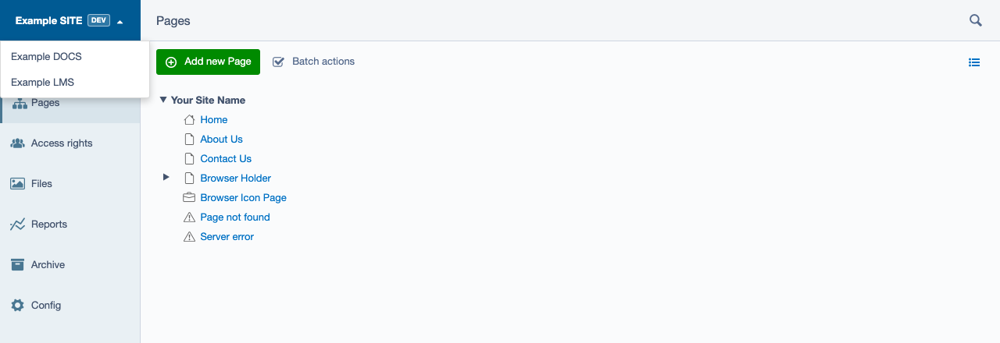
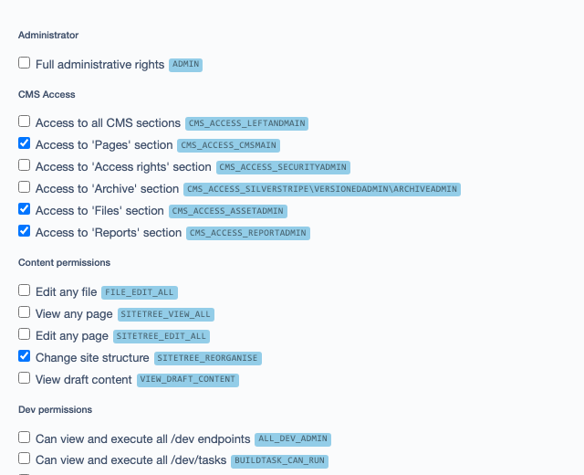
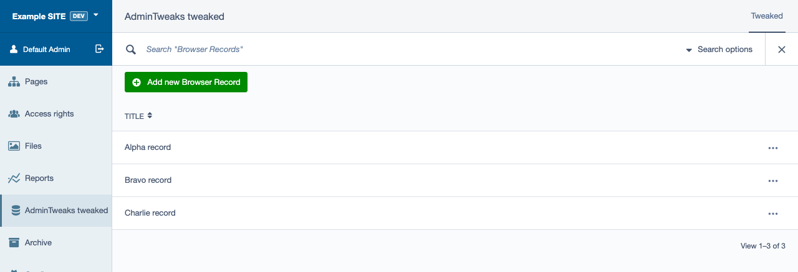
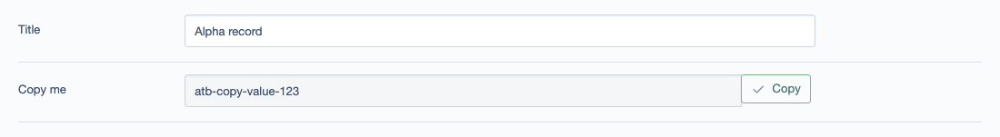

# Admin tweaks for Silverstripe

The small CMS and developer improvements most Silverstripe projects end up writing for themselves,
in one module: a switcher that names the CMS and environment you are in and links to your other
CMSes, page-type icons in the site tree, permission codes next to every permission checkbox,
compact editable GridFields, a toggle switch for checkboxes, a breached-password check, opt-in
ModelAdmin and form-field tweaks, template helpers, deduplicated error mails, and repair tasks for
a migrated asset store. A few sensible defaults apply on install; everything else is switched on
per project. For Silverstripe 6 (the 3.x line covers Silverstripe 4 and 5).



*Maintained by [Restruct](https://github.com/restruct). If this module saves you time, you can
[support ongoing maintenance](https://github.com/sponsors/restruct).*

**Namespace:** `Restruct\Silverstripe\AdminTweaks`

## Contents

- [Requirements and versions](#requirements-and-versions)
- [Installation](#installation)
- [Features at a glance](#features-at-a-glance)
- [CMS interface](#cms-interface)
- [GridField](#gridfield)
- [Form fields](#form-fields)
- [Security](#security)
- [Email and error mails](#email-and-error-mails)
- [Templates, SiteConfig and helpers](#templates-siteconfig-and-helpers)
- [Assets and images](#assets-and-images)
- [Tasks](#tasks)
- [QueuedJobs](#queuedjobs)
- [Configuration reference](#configuration-reference)
- [Building the front-end assets](#building-the-front-end-assets)
- [Tests](#tests)

## Requirements and versions

| Branch | Module version | Silverstripe | PHP | Status |
|--------|----------------|--------------|-----|--------|
| `main` | `4.x` | 6 | 8.3+ | active development |
| `v3` | `3.x` | 4, 5 | as Silverstripe requires | security and bug fixes until Silverstripe 5 EOL (April 2027) |
| `3.0` | `3.0` to `3.11.1` | 4, 5 | as Silverstripe requires | legacy, unmaintained: superseded by `v3` from 3.12.0 |
| `v2` | `2.x` | 4 | as Silverstripe requires | legacy, unmaintained: last release 2.4.0 |

`composer.json` on each branch is the source of truth for exact constraints. Upgrading from 3.x?
See [UPGRADING.md](UPGRADING.md): the CMS menu behaviour and the task invocations both changed.
Release history: [CHANGELOG.md](CHANGELOG.md).

Some features build on other modules, which this module does not require. Install the ones you use:

| Module | Needed for |
|--------|------------|
| `symbiote/silverstripe-gridfieldextensions` | `GridFieldConfigs`, versioned ordering, the editable GridField fixes |
| `silverstripe/lumberjack` | `SelectiveLumberjack`, `GridFieldSiteTreeAddNewButton` |
| `silverstripe/htmleditor-tinymce` | the `minimal` HTML editor config |
| `symbiote/silverstripe-multivaluefield` | `MultivalueSortField` |
| `symbiote/silverstripe-queuedjobs` | the queued-job report recipient and job context in error mails |

## Installation

```bash
composer require restruct/silverstripe-admintweaks:^4   # Silverstripe 6
composer require restruct/silverstripe-admintweaks:^3   # Silverstripe 4 / 5
```

Then flush and build the database (`sake db:build --flush`). The [defaults](#applied-on-install)
apply from then on; the rest is switched on in your project's config.

## Features at a glance

| Area | Feature | On by default? | Details |
|------|---------|----------------|---------|
| CMS interface | [System switcher](#system-switcher) between your CMSes, with an environment badge | no, configure | [System switcher](docs/system-switcher.md) |
| | [Page-type icons](#page-icons) in the site tree | yes | [Icons](docs/icons.md) |
| | [Permission codes](#permission-badges) in the Security admin | yes | |
| | [ModelAdmin](#modeladmin-search-open-csv-buttons-off): search open on load, CSV buttons and import off | no | |
| | [Hide Reports and Campaigns](#hide-the-reports-and-campaigns-sections) | no | |
| | [Bootstrap Icon classes](#bootstrap-icon-classes) for buttons | when a page type uses one | [Icons](docs/icons.md#bootstrap-icon-classes) |
| | [Menu grouping](#menu-grouping) under "Advanced Config" | with grouped-cms-menu | |
| GridField | [One record count, no empty title row](#in-every-gridfield) | yes | [GridField](docs/gridfield.md#in-every-gridfield) |
| | [Editable GridFields](#editable-gridfields): compact rows, row click, unchecked boxes saved | yes | [GridField](docs/gridfield.md#editable-gridfields) |
| | [Ready-made configs and components](#gridfield-configs-and-components) | no | [GridField](docs/gridfield.md) |
| Form fields | [Toggle switch](#toggle-switch) for checkboxes | no | [Form fields](docs/form-fields.md#toggle-switch) |
| | [CopyTextField](#copytextfield) with a copy button | no | [Form fields](docs/form-fields.md#copytextfield) |
| | [`minimal` HTML editor config](#minimal-html-editor-config) | no | [Form fields](docs/form-fields.md#the-minimal-html-editor-config) |
| | [More fields and extensions](#more-form-fields) | no | [Form fields](docs/form-fields.md) |
| Security | [Password policy](#password-policy) | yes | [Security](docs/security.md#password-policy) |
| | [Breached passwords refused](#breached-passwords) (Have I Been Pwned) | on live | [Security](docs/security.md#breached-passwords-have-i-been-pwned) |
| | [`EnforceCMSPermission`](#enforcecmspermission) trait | no | [Security](docs/security.md#enforcecmspermission) |
| Email | [Error mails](#email-and-error-mails) with request details and deduplication | when env vars are set | [Email and error mails](docs/email-logging.md) |
| Templates | [Template helpers](#template-helpers), iterators, image placeholders | yes | [Template helpers](docs/template-helpers.md) |
| | [SiteConfig fields](#siteconfig-fields) | no | [SiteConfig](docs/siteconfig.md) |
| | [Cached HTTP requests](#cached-http-requests) | no | [Caching and helpers](docs/caching.md) |
| Assets | [`File::getLocalPath()`](#assets-and-images), image method fallbacks | yes | [Asset path resolution](docs/asset-path-resolution.md) |
| Tasks | [Repair a migrated asset store](#tasks), query the ORM | run by hand | [Tasks](docs/tasks.md) |

## CMS interface

### System switcher

For organisations running several Silverstripe CMSes side by side: the admin menu header names the
CMS you are in, with a badge for the environment, and opens a dropdown with links to the other
CMSes (screenshot at the top). Off until `systems` is configured:

```yaml
Restruct\Silverstripe\AdminTweaks\SystemSwitcher:
  current: site
  systems:
    site: { display: 'Example SITE', url: 'https://www.example.org/admin' }
    docs: { display: 'Example DOCS', url: 'https://docs.example.org/admin' }
```

Per-environment URLs, the badge, initials in the collapsed menu and the browser tab title:
[System switcher](docs/system-switcher.md).

### Page icons

Every page type gets an icon in the site tree and the "Add page" picker: icons for common page
types (Bootstrap Icons as inline SVG, no font files), and a default page icon for every other type.
A page type can pick any Bootstrap Icon itself:

```yaml
App\Pages\FooPortal:
  cms_icon_class: 'bi-briefcase'
```

On by default; `SilverStripe\Admin\LeftAndMain.page_icons: false` keeps core's page icons. The list
of page types, custom SVG icons and the Silverstripe 5 to 6 rename of `icon_class`:
[Icons](docs/icons.md).

### Permission badges

In the Security admin, every permission checkbox on a group shows its permission code, so
similarly named permissions can be told apart. Always on.



### ModelAdmin: search open, CSV buttons off

Two opt-in settings on any `ModelAdmin` subclass:

```php
class ProductAdmin extends ModelAdmin
{
    // Open the GridField search bar on load instead of hiding it behind the magnifier icon
    private static bool $auto_expand_gridfield_search = true;

    // Hide the scaffolded Export to CSV, Print and Import CSV buttons, and switch the import off
    private static bool $hide_scaffolded_csv_buttons = true;
}
```



The scaffolded export just dumps the summary fields, and the default `CsvBulkLoader` import is a
data-integrity risk on synced or managed models. `hide_scaffolded_csv_buttons` also switches the
CSV import itself off (`$showImportForm = false`), not only its button: without that, ModelAdmin
keeps accepting a hand-built import POST. To apply it to every ModelAdmin:

```yaml
SilverStripe\Admin\ModelAdmin:
  hide_scaffolded_csv_buttons: true

# SecurityAdmin is a ModelAdmin too; keep its member/group CSV import if you use it
SilverStripe\Admin\SecurityAdmin:
  hide_scaffolded_csv_buttons: false
```

### Hide the Reports and Campaigns sections

Opt-in since 4.1 ([#54](https://github.com/restruct/silverstripe-admintweaks/issues/54)), and
applied at runtime, so no `After:` ordering is needed to override it:

```yaml
SilverStripe\Admin\LeftAndMain:
  hide_rarely_used_menu_sections: true
```

The sections keep working at their URLs; only the menu items go. While the setting is unset, dev
environments log a one-off notice about the change from 3.x; set it to `false` to keep the sections
and silence the notice. See [UPGRADING.md](UPGRADING.md).

### Bootstrap Icon classes

Standard `bi bi-*` classes for buttons and other admin UI, mirroring core's `.font-icon-*`
pattern. The Bootstrap Icons stylesheet loads from a CDN by itself once a page type uses a `bi-*`
icon class; `include_bootstrap_icons: true` always loads it, `false` never does:

```yaml
SilverStripe\Admin\LeftAndMain:
  include_bootstrap_icons: true
```

```php
FormAction::create('add', 'Add Item')->addExtraClass('bi bi-plus-circle');
```

The CDN URL and icon-only buttons: [Icons](docs/icons.md#bootstrap-icon-classes).

### Menu grouping

With a grouped-menu module installed, the configuration sections (Settings, Archive, Redirects,
Subsites, Queued Jobs and restruct/silverstripe-blockbase's blocks admin, those that are installed)
are grouped under "Advanced Config" in the menu. Nothing to configure.

The module is `xddesigners/silverstripe-grouped-cms-menu`. The group needs two or more of those
sections installed to show as a group. That module also removes the Help menu item and loads Font
Awesome from a CDN by default; both are its own settings, see its README.

On Silverstripe 4/5 (the v3 branch) the same group works with `symbiote/silverstripe-grouped-cms-menu`
instead, which has no Silverstripe 6 release (2026-11).

### Smaller fixes

Always on, CSS only unless noted:

- Uploaded images with transparency show on a light checkerboard in upload fields.
- Form inputs use near-black text instead of the admin's grey.
- Elemental blocks lose the faux "stacked" layout, and Elemental's popover is wide enough.
- A JavaScript workaround stops the admin's entwine layer from aborting on HTML comments in
  pjax-loaded forms, which could leave some fields (HTML editors, for example) uninitialised.

## GridField

### In every GridField

`GridFieldPageCount` is removed from the GridField configs, so "View 1-3 of 3" shows once, in the
footer, and the title row that held it is hidden while it is empty. Checkbox sets in the "Search
options" popover no longer overlap, and long option lists scroll. Details:
[GridField](docs/gridfield.md#in-every-gridfield).

### Editable GridFields

For GridFields with gridfieldextensions' `GridFieldEditableColumns`, on install:


- **Compact rows**: fields no longer bring Bootstrap's form spacing into the row, and cells line
  up on their first line.
- **A click on the row opens the record**, as in any other GridField; a click inside a field's cell
  stays with the field.
- **Unticking a checkbox is saved**: an unticked box posts an empty value instead of nothing.

How each works, and a toggle switch in a column: [GridField](docs/gridfield.md#editable-gridfields).

### GridField configs and components

```php
use Restruct\Silverstripe\AdminTweaks\Forms\GridFieldConfigs;

// Inline editing with drag-and-drop ordering
$config = GridFieldConfigs::editable_orderable();

// Sorting, filtering and ordering, with the usual detail form
$config = GridFieldConfigs::filterable_orderable_recordeditor();
```

Also: `GridFieldConfig_VersionedOrderable` (ordering of versioned records written to live at
once), `SelectiveLumberjack` (hide only the child page types you list from the site tree),
`GridFieldSiteTreeAddNewButton` and `SortableExtension`. All in [GridField](docs/gridfield.md).

## Form fields

### Toggle switch

Draws a checkbox as a switch like the admin's own. CSS only: the checkbox stays a checkbox for the
keyboard, screen readers and the form value.

```php
CheckboxField::create('Active')->setToggleSwitch();
CheckboxSetField::create('Channels', 'Channels', $options)->setToggleSwitch();
```


`setToggleSwitch()` is a shorthand for `addExtraClass('toggle-switch')`. Disabled switches are
faded. `setToggleSwitchInverted()` shows the switch ON while the box is unchecked, for a stored
negative flag ("Hidden"); display only, so screen readers still announce the real state. In an editable GridField column, read-only behaviour and the CSS custom properties for size
and colour: [Form fields](docs/form-fields.md#toggle-switch).

### CopyTextField

A read-only field with a copy-to-clipboard button, which turns green with a check for two seconds
after copying.

```php
use Restruct\Silverstripe\AdminTweaks\FormFields\CopyTextField;

CopyTextField::create('ApiKey', 'API Key', $apiKey)->setButtonLabel('Copy');
```



All options: [Form fields](docs/form-fields.md#copytextfield).

### Minimal HTML editor config

An HTML editor config named `minimal` for short rich-text fields: one toolbar line with bold,
italic, bullet and numbered lists, links and "clear formatting". It is a copy of the `cms` config,
so the link dialogs work. Needs `silverstripe/htmleditor-tinymce`.

```php
use Restruct\Silverstripe\AdminTweaks\Forms\MinimalEditorConfig;

HTMLEditorField::create('Answer')->setEditorConfig(MinimalEditorConfig::get());
```

Changing the toolbar and allowing more HTML:
[Form fields](docs/form-fields.md#the-minimal-html-editor-config).

### More form fields

- **MultivalueSortField**: drag-and-drop sorting of a fixed set of options (needs
  `symbiote/silverstripe-multivaluefield`).
- **IpAddressField**: a text field that only accepts an IPv4 or IPv6 address.
- **FormFieldBootstrapExtension** (opt-in): Bootstrap's `form-control`, `form-select` and
  `form-check` classes on front-end form fields.
- **FormFieldTweaksExtension** (opt-in): attributes on a field's holder, Bootstrap validation
  classes, and a floating-label holder template.

All in [Form fields](docs/form-fields.md).

## Security

### Password policy

Core's `RulesPasswordValidator` with minimum length 12, a history of 6 and a minimum test score of
3 on live; minimum length 5 and no history check on dev and test, so a local `admin:admin` works.
How to change it: [Security](docs/security.md#password-policy).

### Breached passwords

On live, a new password that occurs in the [Have I Been Pwned](https://haveibeenpwned.com/Passwords)
breach data is refused. Only the first 5 characters of the password's SHA-1 hash are sent
(k-anonymity), and when the lookup fails the password is accepted and a warning logged. Off on dev
and test. Opt in to also expire a breached password a member logs in with, so they must choose a
new one:

```yaml
Restruct\Silverstripe\AdminTweaks\Security\BreachedPasswords:
  expire_on_login: true
```

All settings: [Security](docs/security.md#breached-passwords-have-i-been-pwned).

### EnforceCMSPermission

A trait that ties a DataObject's `canView`, `canEdit`, `canDelete` and `canCreate` to Pages
section access (`CMS_ACCESS_CMSMain`) of the current user:

```php
class MyDataObject extends DataObject
{
    use \Restruct\Silverstripe\AdminTweaks\Traits\EnforceCMSPermission;
}
```

Note that it ignores the `$member` argument: [Security](docs/security.md#enforcecmspermission).

## Email and error mails

Set in `.env`; each part switches on only when its variables are set.

```ini
# Default sender (Email.admin_email), when the project has not set one
APP_SYSTEM_EMAIL_SENDER="My App"
APP_SYSTEM_EMAIL_ADDRESS="noreply@example.com"

# Error mails, only when all four are set: leave them out on dev and test
APP_LOG_MAIL_RECIPIENT="admin@example.com"
APP_LOG_MAIL_SUBJECT="Error on MyApp"
APP_LOG_MAIL_SENDER="noreply@example.com"
APP_LOG_MAIL_LEVEL="error"
```

Error mails carry the request and server details. The same error is mailed once per 5 minutes and
at most 20 error mails go out per hour, so an outage does not flood the inbox. SMTP is configured
with Symfony Mailer's `MAILER_DSN`; the `APP_SMTP_*` variables of the 3.x line do nothing here.
Formatter, limits and troubleshooting: [Email and error mails](docs/email-logging.md).

## Templates, SiteConfig and helpers

### Template helpers

Available in every template, on install:

```html
<% if $IsDev %>Debug mode<% end_if %>

<% include ImagePlaceholder W=180, H=50, Label='logo' %>

<video src="{$themeDirResourceURL('my-theme')}/video.mp4"></video>

<% loop $Items %>
  <div class="col-{$GroupSize}-of-4">$Title</div>
<% end_loop %>
```

Page helpers, iterators, date and time formatting, shortcodes: [Template helpers](docs/template-helpers.md).

### SiteConfig fields

Opt-in fields for contact details, social media, a browser theme colour, raw HTML in head and body,
logos and theme settings:

```yaml
SilverStripe\SiteConfig\SiteConfig:
  extensions:
    - Restruct\Silverstripe\AdminTweaks\Extensions\SiteConfigExtension
  enable_contact_social_media_fields: true
  enable_raw_head_body_fields: true
```

Every option: [SiteConfig](docs/siteconfig.md).

### Cached HTTP requests

```php
use Restruct\Silverstripe\AdminTweaks\Helpers\CacheHelpers;

$data = CacheHelpers::cached_json_request('https://api.example.com/data', 'GET', [], 3600);
$jsonLdBlocks = CacheHelpers::cached_jsonLD_request('https://example.com/product');
```

More, including `GeneralHelpers`: [Caching and helpers](docs/caching.md).

## Assets and images

- **`$file->getLocalPath()`**: the absolute path of a file on a local disk (for command-line tools
  such as `pdftotext`), found the way the framework itself finds the file, protected store first.
  Returns `null` for a file that is not on a local disk. [Asset path resolution](docs/asset-path-resolution.md).
- **Image method fallbacks**: while the FocusPoint module or Restruct's image cropper is not
  installed, their template methods (`FocusFillMax`, `CroppedFocusedImage` and others) fall back
  to core manipulations, and some Silverstripe 3 names (`SetWidth`, `PaddedImage`) still work.
  [Caching and helpers](docs/caching.md#image-method-fallbacks).
- Image quality 90; WEBP output and MIME upload validation switch on with their modules (see
  [Applied on install](#applied-on-install)).
- **`GeneralHelpers::import_file_asset()`**: stores a downloaded URL or a local file as a File or
  Image. URLs go through the outbound URL checks; a local path or `file:` URL is read only when
  the caller names the directory it must be in. [Caching and helpers](docs/caching.md#import_file_asset).

## Tasks

Three dry-run-by-default tasks that repair asset artifacts left behind by a migration from
Silverstripe 3 or 4 (folders that break the Files section, images stored as plain files, missing
CMS thumbnails), and two developer tools:

```bash
sake tasks:fix-folder-filefilename --apply
sake tasks:fix-misclassified-images --apply
sake tasks:generate-cms-thumbnails --apply
sake tasks:orm-query --class=Member --limit=5
sake tasks:focuspoint-invert-yaxis
```

What each fixes, the order to run them in, and the options: [Tasks](docs/tasks.md).

## QueuedJobs

`ScheduledMethodCall`, the cleanup-broken-jobs task and the `qjob-profile` task moved to
[restruct/silverstripe-queuedjobs-enhancements](https://github.com/restruct/silverstripe-queuedjobs-enhancements).
What this module still does for `symbiote/silverstripe-queuedjobs`: fill
`Email.queued_job_admin_email` from `APP_LOG_MAIL_RECIPIENT` when the project has not set it, and
name the running job in error mails from the queue runner
([Email and error mails](docs/email-logging.md#queued-job-reports)).

## Configuration reference

### Applied on install

- `Session.cookie_secure: true`: session cookies over HTTPS only.
- UserDefinedForm submissions are not stored by default (`DisableSaveSubmissions`), for GDPR.
- Image backend quality 90 (`Image_Backend.Quality`).
- URL segments: `&` becomes `-et-` instead of core's `-and-` (no other replacement changed).
- The [password policy](#password-policy) and the [breached-password check](#breached-passwords).
- Cache lifetimes: `cacheblock` (template `<% cached %>`) 24 hours; `appcache` and `adminCache` 1 hour.
- The page icons, permission badges, GridField and editable GridField changes described above.
- From env, only when the project has not set them: `Email.admin_email` and
  `Email.queued_job_admin_email` (see [Email and error mails](#email-and-error-mails)).

### With other modules installed

| Module | What happens |
|--------|--------------|
| `xddesigners/silverstripe-grouped-cms-menu` | Admin sections grouped under "Advanced Config" |
| `symbiote/silverstripe-queuedjobs` | Job context in error mails; report recipient from env |
| `wilr/silverstripe-googlesitemaps` | Sitemap enabled: 1000 objects per sitemap, Google and Bing notification on, honours `ShowInSearch` |
| `silverstripe/mimevalidator` | MIME upload validation active |
| `wedevelopnl/silverstripe-webp-images` | WEBP output at quality 80 (no Silverstripe 6 release of that module yet) |
| `restruct/silverstripe-shortcodable` | `[currentyear]` and `[featuredimage]` shortcodes registered |

### Settings

| Class | Setting | Default | See |
|-------|---------|---------|-----|
| `SilverStripe\Admin\LeftAndMain` | `page_icons` | `true` | [Page icons](#page-icons) |
| | `include_bootstrap_icons` | unset: when a page type uses a `bi-*` class | [Bootstrap Icon classes](#bootstrap-icon-classes) |
| | `bootstrap_icons_cdn_url` | jsDelivr, bootstrap-icons 1.13.1 | [Icons](docs/icons.md#configuration) |
| | `hide_rarely_used_menu_sections` | unset: shown, with a dev notice | [Hide Reports and Campaigns](#hide-the-reports-and-campaigns-sections) |
| `SilverStripe\Admin\ModelAdmin` | `auto_expand_gridfield_search` | `false` | [ModelAdmin](#modeladmin-search-open-csv-buttons-off) |
| | `hide_scaffolded_csv_buttons` | `false` | [ModelAdmin](#modeladmin-search-open-csv-buttons-off) |
| `Restruct\Silverstripe\AdminTweaks\SystemSwitcher` | `current`, `systems`, `environment_suffixes` | off until `systems` is set | [System switcher](docs/system-switcher.md) |
| `Restruct\Silverstripe\AdminTweaks\Security\BreachedPasswords` | `enabled` | `true` on live, `false` elsewhere | [Security](docs/security.md#settings) |
| | `min_breach_count` | `1` | [Security](docs/security.md#settings) |
| | `expire_on_login` | `false` | [Security](docs/security.md#expiring-a-breached-password-at-login) |
| `Restruct\Silverstripe\AdminTweaks\Forms\MinimalEditorConfig` | `minimal_buttons`, `minimal_options` | one toolbar line | [Form fields](docs/form-fields.md#configuration) |
| `Restruct\Silverstripe\AdminTweaks\Logging\DedupSymfonyMailerHandler` | `dedup_time`, `max_emails_per_window`, `rate_window` | `300`, `20`, `3600` | [Email and error mails](docs/email-logging.md#dedupsymfonymailerhandler) |
| `Restruct\Silverstripe\AdminTweaks\Logging\EnhancedErrorFormatter` | `format_mode`, `server_vars` | `html`, a list of request keys | [Email and error mails](docs/email-logging.md#enhancederrorformatter) |
| `SilverStripe\SiteConfig\SiteConfig` | `enable_*` and theme settings | off | [SiteConfig](docs/siteconfig.md) |

## Building the front-end assets

The built CSS and JS in `client/dist/` are committed, so installing the module needs no Node
tooling. To change them, edit `client/src/` and rebuild with [Vite](https://vite.dev), from a
checkout of the module (Node `^20.19` or `>=22.12`; the lockfile is `yarn.lock`):

```bash
yarn install
yarn build    # minified, what gets committed
yarn dev      # unminified, with inline source maps
yarn watch    # as dev, rebuilding on every change
```

`build-assets.mjs` holds the build configuration. The output names (`client/dist/css/admintweaks.css`,
`client/dist/css/admintweaks-page-icons.css`, `client/dist/css/multivaluesortfield.css`,
`client/dist/js/admintweaks.js`, and the FontAwesome webfonts in `client/dist/fonts/`) are fixed,
because the YAML config and the PHP load them by path. Commit `client/src` and `client/dist`
together, built with `yarn build`.

## Tests

The PHPUnit suite in `tests/` needs a Silverstripe 6 host project with
`silverstripe/recipe-testing`; `.github/workflows/ci.yml` builds one and is the reference.

Browser tests (Playwright, against a real CMS) live in `tests/browser/` and run in
`.github/workflows/browser-tests.yml`. The screenshots in this README and in `docs/` are generated
from the same fixtures; see [tests/browser/screenshots/README.md](tests/browser/screenshots/README.md)
to regenerate them.

## License

MIT, see [LICENSE](LICENSE).
