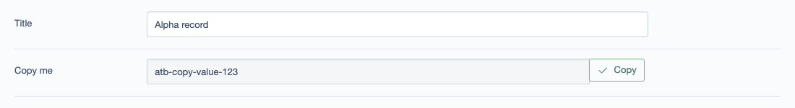
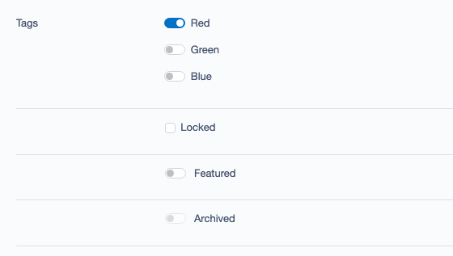

# Form fields

The form fields, the toggle switch, the `minimal` HTML editor config and the form field
extensions this module ships. None of them changes an existing form until a project uses it.

## CopyTextField

A read-only text field with a copy-to-clipboard button, for API keys, URLs and other values people
need to copy. After a click the button turns green with a check mark for two seconds.



### Basic Usage

```php
use Restruct\Silverstripe\AdminTweaks\FormFields\CopyTextField;

$field = CopyTextField::create('ApiKey', 'API Key', $this->ApiKey);
```

### Configuration Options

```php
$field = CopyTextField::create('ShareUrl', 'Share URL', $this->AbsoluteLink())
    ->setButtonLabel('Copy URL')
    ->setShowAlert(true)
    ->setAlertMessage('URL copied')
    ->setDescription('Click to copy this URL to clipboard');
```

| Setter | Default | What it does |
|--------|---------|--------------|
| `setButtonLabel(?string)` | none (icon only) | Text on the button next to the icon |
| `setButtonTitle(?string)` | "Copy to clipboard" (translatable) | The button's tooltip |
| `setButtonClasses(string)` | `btn btn-outline-secondary` | CSS classes of the button |
| `setShowAlert(bool)` | `false` | Also show a browser alert after copying |
| `setAlertMessage(?string)` | none | The alert's text; without one no alert shows, also with `setShowAlert(true)` |
| `setIsReadonly(bool)` | `true` | Whether the input is read-only |

Copying uses the browser's Clipboard API, which needs HTTPS (or `localhost`).

### Template

The field renders `templates/Restruct/Silverstripe/AdminTweaks/FormFields/CopyTextField.ss`, with
Bootstrap classes and SVG icons for the copy and success states; a theme can override it.

---

## MultivalueSortField

A sort-only variant of `MultiValueDropdownField` from
[symbiote/silverstripe-multivaluefield](https://github.com/symbiote/silverstripe-multivaluefield),
which must be installed: items are reordered by drag and drop, but cannot be added or removed.
For a custom sort order over a fixed set of options.

```php
use Restruct\Silverstripe\AdminTweaks\FormFields\MultivalueSortField;

$field = MultivalueSortField::create('SortOrder', 'Item order', [
    '1' => 'First item',
    '2' => 'Second item',
    '3' => 'Third item',
]);
```

The field loads its own stylesheet (`client/dist/css/multivaluesortfield.css`) when it renders.

---

## The minimal HTML editor config

An HTML editor config named `minimal` for short rich-text fields (FAQ answers, intro texts, card
texts): one toolbar line with bold, italic, bullet and numbered lists, the link menu and "clear
formatting". Such fields need less than the full `cms` toolbar (alignment, indent, tables,
headings, embeds), and the smaller toolbar keeps their content clean.

### Usage

```php
use Restruct\Silverstripe\AdminTweaks\Forms\MinimalEditorConfig;
use SilverStripe\Forms\HTMLEditor\HTMLEditorField;

$field = HTMLEditorField::create('Answer')->setEditorConfig(MinimalEditorConfig::get());
```

`MinimalEditorConfig::get()` returns the config object, the same one on every call. On
Silverstripe 6 the name works as well, also before the getter has been called:
`setEditorConfig(MinimalEditorConfig::NAME)` or `HTMLEditorConfig::get('minimal')`. The getter is
what the 3.x line (Silverstripe 4 and 5) needs, so code that uses it reads the same on both.

Getting the config is what makes the copy (see below), so do not get it in a `_config.php`: the
copy would then be made before every module has set up `cms`. Change the toolbar through YAML
instead (see Configuration).

On Silverstripe 6 TinyMCE is a separate module; the class and the config only exist when
`silverstripe/htmleditor-tinymce` is installed.

### How it is built

The config is a copy of the `cms` config, made the first time `minimal` is requested. It keeps
what `cms` has at that moment: the link plugins and their menu (page, file, external URL, anchor,
email), the skin, the content CSS, and whatever a project's own `_config.php` added to `cms`. A
copy made in a `_config.php` could miss some of that, because the `_config.php` that sets up
`cms` can run after it.

On Silverstripe 6 the copy gets the framework's default element rules, not the extra iframe,
object and map rules of `cms`. Allow more HTML with `extraElementRules`, as core does for `cms`:

```yaml
SilverStripe\Forms\HTMLEditor\HTMLEditorConfig:
  default_config_definitions:
    minimal:
      extraElementRules:
        span:
          attributes:
            class: true
```

A project that registers its own `minimal` (`HTMLEditorConfig::set_config('minimal', ...)`)
keeps it; the copy is only made when there is no `minimal` yet.

### Configuration

The toolbar is one space-separated string of TinyMCE button names per line (`|` is a
separator). An empty string leaves the line out; lines the `cms` config has and this list does
not name are emptied as well.

```yaml
Restruct\Silverstripe\AdminTweaks\Forms\MinimalEditorConfig:
  minimal_buttons:
    line_1: 'bold italic | bullist numlist | sslink unlink | removeformat'
    line_2: ''
    line_3: ''
  minimal_options:
    friendly_name: 'Simple'
    contextmenu: 'sslink'
```

These are the defaults. Use strings, not lists: Silverstripe config adds a list you set to the
module's list instead of replacing it, so a list of buttons would end up after the default ones.

`minimal_options` are TinyMCE options set on the copy. `contextmenu: 'sslink'` replaces the `cms`
right-click menu (tables, media, anchors) with the link menu.

`unlink` is in the default list, as it is in core's own `cms` toolbar, and as there it only
renders when TinyMCE's core `link` plugin is enabled, which the `cms` config does not do. Without
it the button is left out and the toolbar shows the other five buttons.

---

## Toggle switch



Show a checkbox as a toggle switch: opt in per field with the `toggle-switch` class. It is CSS
only, in the module's admin stylesheet: the native `<input type="checkbox">` itself is drawn as
the switch (`appearance: none`, the knob is its `::before`). No JavaScript, no extra markup and
no third-party library, so:

- the click target is still the checkbox: in an editable GridField a click on the switch toggles
  it and does not open the row, and the hidden input that makes an unchecked box in a GridField
  row submit `0` keeps working;
- the keyboard (Tab, Space) and screen readers see a plain checkbox, with its own label;
- it works in forms loaded later (pjax, a new GridField row), as there is nothing to initialise.

It looks like the admin's own Bootstrap 5 switch (`.form-switch`): 2em by 1em, the same border, knob,
checked colour and focus ring, and the admin's keyboard focus outline. Disabled switches are faded and do not react to the pointer.

### CheckboxField

```php
CheckboxField::create('Active')->setToggleSwitch();
// the same, by hand:
CheckboxField::create('Active')->addExtraClass('toggle-switch');
```

On Silverstripe 6 the extra class lands on the `<input>` and on the field's holder `<div>`. The switch
lines up with plain checkboxes in the same form; its label text starts after it.

### CheckboxSetField

```php
CheckboxSetField::create('Channels', 'Channels', $options)->setToggleSwitch();
```

A CheckboxSetField's extra class lands on the element that wraps its options, not on each option's
`<input>` (the options are rendered from the template's loop and take no class of their own). The
CSS therefore also matches every checkbox *inside* an element with the class
(`.toggle-switch input[type=checkbox]`), so all options become switches. The same holds for any
container: a class on a CompositeField or FieldGroup turns every checkbox in it into a switch.

### In an editable GridField column

`GridFieldEditableColumns` builds a column's field from the column config, so a plain
`'field' => CheckboxField::class` cannot take the class. Build the field in a `callback` instead
(it gets the record, the column name and the GridField):

```php
$editable = GridFieldEditableColumns::create();
$editable->setDisplayFields([
    'Title' => ['title' => 'Title', 'field' => TextField::class],
    'Active' => [
        'title' => 'Active',
        'callback' => fn ($record, $column) => CheckboxField::create($column)->setToggleSwitch(),
    ],
]);
```

### `setToggleSwitch()`

`ToggleSwitchExtension` adds `setToggleSwitch(bool $enable = true)` (chainable; `false` removes the
class again) and `isToggleSwitch()` to `CheckboxField` and `CheckboxSetField`. It is a shorthand
for the class and changes nothing until a field calls it; adding the class by hand is equivalent.

### Read-only and disabled

- `setDisabled(true)`: still drawn as a switch, faded; it cannot be toggled.
- A read-only field (`performReadonlyTransformation()`, or a record the user cannot edit in an
  editable GridField) is rendered by core as text ("Yes"/"No", or the option titles), not as a
  checkbox, so there is no switch to show.
- The HTML `readonly` attribute does not stop a checkbox from toggling (browsers ignore it on
  checkboxes); a switch with it is faded like a disabled one, but use `setDisabled(true)` to
  actually stop changes.

### Changing the look

The sizes and colours are custom properties on the switch, so a project stylesheet can override
them, e.g. a larger green switch:

```css
input[type="checkbox"].toggle-switch,
.toggle-switch input[type="checkbox"] {
    --toggle-switch-width: 2.5rem;
    --toggle-switch-height: 1.25rem;
    --toggle-switch-checked: #008a00;
}
```

Also available: `--toggle-switch-bg` (the track when off), `--toggle-switch-border`,
`--toggle-switch-knob` (the knob when off; it is white when on) and `--toggle-switch-focus-border`.

---

## IpAddressField

A text field that accepts an IPv4 or IPv6 address (PHP's `FILTER_VALIDATE_IP`). An empty value is
left to a required-fields validator. The error message is Dutch and not translatable yet.

### Usage

```php
use Restruct\Silverstripe\AdminTweaks\FormFields\IpAddressField;

$field = IpAddressField::create('AllowedIP', 'Allowed IP Address');
```

---

## Form Field Extensions

### FormFieldBootstrapExtension

Adds Bootstrap form classes to form fields when they render, for front-end forms styled with
Bootstrap. Opt-in.

#### Enable

```yaml
SilverStripe\Forms\FormField:
  extensions:
    - Restruct\Silverstripe\AdminTweaks\Extensions\FormFieldBootstrapExtension
```

#### Applied Classes

| Field class | Class added |
|-------------|-------------|
| `TextField`, `TextareaField`, `EmailField`, `PasswordField`, `NumericField`, `CurrencyField`, `DateField` | `form-control` |
| `DropdownField` | `form-select` |
| `CheckboxField`, `CheckboxSetField`, `OptionsetField` | `form-check` |

The class is matched exactly, so a subclass of one of these fields gets no class.

---

### FormFieldTweaksExtension

Attributes on a field's holder, and Bootstrap validation classes: a field with a message gets
`is-valid` (a "good" message) or `is-invalid` (any other). Opt-in.

#### Enable

```yaml
SilverStripe\Forms\FormField:
  extensions:
    - Restruct\Silverstripe\AdminTweaks\Extensions\FormFieldTweaksExtension
```

#### Usage

```php
// Add attributes to the field holder (not the input)
$field->setHolderAttribute('data-custom', 'value');
$field->getHolderAttribute('data-custom');   // 'value'

// Use with custom holder template
$field->setFieldHolderTemplate('FormFieldTweaks_holder');
```

#### Custom Holder Template

`templates/FormFieldTweaks_holder.ss` is a Bootstrap 5 floating-label holder that renders the
holder attributes (`$HolderAttributesHTML`), an optional `$Append`/`$AppendTxt` input-group addon,
and the message as `valid-feedback`/`invalid-feedback`.

---

## DataObjectExtension

Applied to every DataObject on install.

### fieldLabelToLower()

Returns a field's (translated) label in lower case:

```php
// In a DataObject
$label = $this->fieldLabelToLower('FirstName'); // "first name"
```

Useful for generating natural-language messages.
