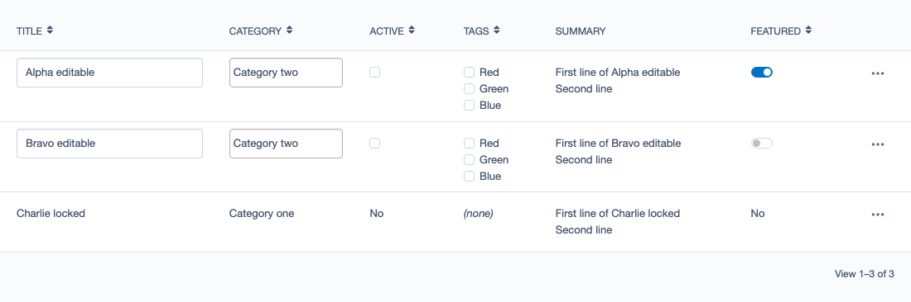

# GridField

What the module changes in every GridField, what it adds to editable GridFields, and the
ready-made configurations and components it ships.

Most of the components here come from
[symbiote/silverstripe-gridfieldextensions](https://github.com/symbiote/silverstripe-gridfieldextensions)
or [silverstripe/lumberjack](https://github.com/silverstripe/silverstripe-lumberjack). Neither is a
requirement of this module; install the one you use:

| Feature | Needs |
|---------|-------|
| `GridFieldConfigs`, `GridFieldConfig_VersionedOrderable`, editable GridFields | `symbiote/silverstripe-gridfieldextensions` |
| `GridFieldSiteTreeAddNewButton`, `SelectiveLumberjack` | `silverstripe/lumberjack` |

The classes that extend a component from these modules are not declared while that module is
missing, so the site keeps working without them.

## In every GridField

Applied on install, nothing to configure:

- **One record count**: `GridFieldPageCount` ("View 1-3 of 3") is removed from the GridField
  configs that fire `updateConfig` (`GridFieldConfig_Base`, `_RecordEditor`, `_RecordViewer`,
  `_RelationEditor` and their subclasses), so the count shows once, in the footer.
- **No empty title row**: the GridField title row that held that count is hidden while it stays
  empty (no title, nothing in either header fragment), so no blank band is left above the column
  headers (CSS only).
- **Search options popover**: checkboxset and optionset holders no longer collapse or overlap
  when a `form-control` class leaks onto the field holder (for example from project code that
  decorates scaffolded search fields for front-end reuse), and long option lists scroll within
  the popover (CSS only).
- **Icon actions without an action menu** (the edit pencil, for example) no longer give a long grid
  a second scrollbar.

## Editable GridFields

For GridFields with gridfieldextensions' `GridFieldEditableColumns`, also applied on install:



- **Compact rows**: inputs, dropdowns, checkboxes and checkbox sets no longer bring Bootstrap's
  form spacing into the row, so an editable row is about as high as a plain one. Cells line up on
  their first line, so a multi-line cell (a checkbox set, a wrapped text) does not pull the
  single-line fields of its row down to its middle.
- **A click on the row opens the record**, as in any other GridField. gridfieldextensions stops the
  click for the whole row once it holds an editable field, so the pointer cursor showed but nothing
  happened. Now a click on the row's own space opens the detail form (Cmd/Ctrl/Shift-click opens a
  new tab, as core does). A click inside a cell that holds an editable field belongs to that field,
  also when a widget (a toggle switch, a select2 or chosen dropdown, a date or colour picker) draws
  its own markup next to it. Links, buttons and the action menu keep their own behaviour, and rows
  without an edit link do nothing.
- **Unchecked checkboxes are saved**: a browser submits nothing for an unticked checkbox, so
  `GridFieldEditableColumns` never saw a box being unticked
  ([gridfieldextensions#77](https://github.com/symbiote/silverstripe-gridfieldextensions/issues/77)).
  When a checkbox in a row is unticked, a hidden input with the same name is put in front of it,
  so the form posts an empty value and the field is set to false.
- **Toggle switches in a column**: a checkbox column can be drawn as a switch, built in the
  column's `callback`; see [Form fields](form-fields.md#in-an-editable-gridfield-column).

```php
use Symbiote\GridFieldExtensions\GridFieldEditableColumns;

$editable = GridFieldEditableColumns::create();
$editable->setDisplayFields([
    'Title' => ['title' => 'Title', 'field' => TextField::class],
    'Active' => [
        'title' => 'Active',
        'callback' => fn ($record, $column) => CheckboxField::create($column)->setToggleSwitch(),
    ],
]);
```

## GridFieldConfigs

Static methods returning ready-made configurations.

### editable_orderable()

Inline editing with drag-and-drop ordering, for simple related records:

```php
use Restruct\Silverstripe\AdminTweaks\Forms\GridFieldConfigs;
use SilverStripe\Forms\GridField\GridField;

$grid = GridField::create('Items', 'Items', $this->Items(), GridFieldConfigs::editable_orderable());
```

Components: `GridFieldButtonRow` (after the grid), `GridFieldToolbarHeader`,
`GridFieldTitleHeader`, `GridFieldEditableColumns`, `GridFieldOrderableRows`,
`GridFieldDeleteAction` and `GridFieldAddNewInlineButton`.

### filterable_orderable_recordeditor($showAdd = null)

Sorting, filtering, drag-and-drop ordering and the usual detail form:

```php
$grid = GridField::create('Products', 'Products', $this->Products(),
    GridFieldConfigs::filterable_orderable_recordeditor());
```

Components: `GridFieldButtonRow` (before the grid), `GridFieldAddNewButton`,
`GridFieldToolbarHeader`, `GridFieldSortableHeader`, `GridFieldFilterHeader`,
`GridFieldDataColumns`, `GridFieldEditButton`, `GridFieldDeleteAction`, `GridField_ActionMenu`,
`GridFieldDetailForm` and `GridFieldOrderableRows`. The sortable and filter headers do not throw
on a column they cannot sort or filter. `$showAdd` is passed on to `GridFieldDetailForm`.

## GridFieldConfig_VersionedOrderable

Despite its name, a component: a `GridFieldOrderableRows` for versioned records that writes the new
sort order to the live table straight away, without creating versions or a change set, so a
re-ordered list is live without publishing every record.

```php
use Restruct\Silverstripe\AdminTweaks\Forms\GridFieldConfig_VersionedOrderable;
use Symbiote\GridFieldExtensions\GridFieldOrderableRows;

$config->removeComponentsByType(GridFieldOrderableRows::class);
$config->addComponent(GridFieldConfig_VersionedOrderable::create());
```

`setUpdateLiveTableImmediately(false)` makes it write a normal new version per record instead, like
the parent component.

## GridFieldSiteTreeAddNewButton

Lumberjack's "Add new" button for child pages, which also offers the page types a holder hides
from the site tree through `hide_from_cms_tree`, when the user may create them under that holder.
`SelectiveLumberjack` uses it; to use it in your own Lumberjack config:

```php
use Restruct\Silverstripe\AdminTweaks\Forms\GridFieldSiteTreeAddNewButton;

$config->addComponent(GridFieldSiteTreeAddNewButton::create('buttons-before-left'));
```

## SelectiveLumberjack

A Lumberjack extension for holder pages that hides only the child page types listed in the
holder's core `hide_from_cms_tree` config from the site tree (as well as the ones Lumberjack hides
itself), and lists them in the holder's child pages GridField instead:

```php
use Restruct\Silverstripe\AdminTweaks\Extensions\SelectiveLumberjack;

class NewsHolder extends Page
{
    private static $extensions = [SelectiveLumberjack::class];

    private static $hide_from_cms_tree = [NewsArticle::class];
}
```

The filter applies to the site tree (also once a page is open in the editor), not to the list
view, which is meant for long lists of pages. The GridField is Lumberjack's, with
`GridFieldSiteTreeAddNewButton` and without the toolbar header, record count and sortable header.
A holder can supply its own config with a `getLumberjackGridFieldConfig()` method.

## SortableExtension

Adds an integer `Sort` field to a DataObject, keeps it out of the CMS fields, and gives a new record
the highest `Sort` plus one, so it is added at the end of an orderable list.

```yaml
App\Model\Slide:
  extensions:
    - Restruct\Silverstripe\AdminTweaks\Extensions\SortableExtension
  default_sort: 'Sort ASC'
```
